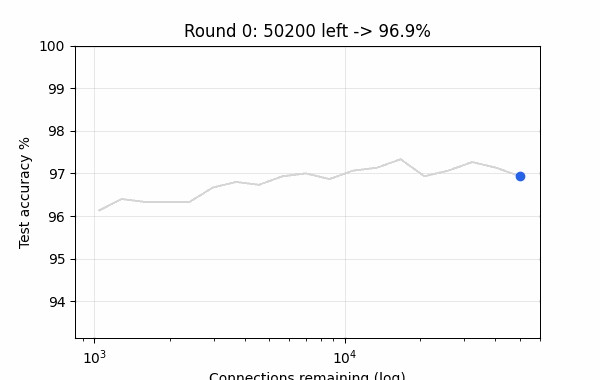
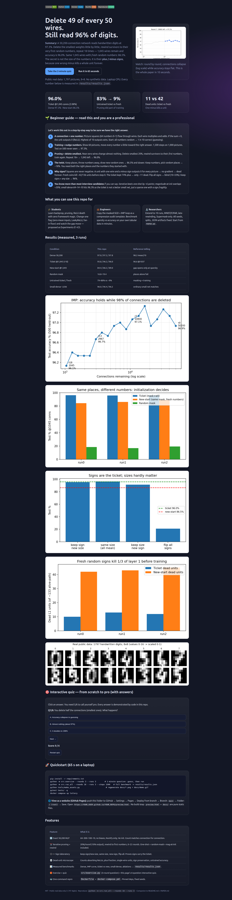
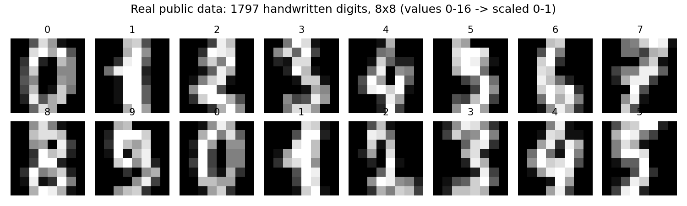
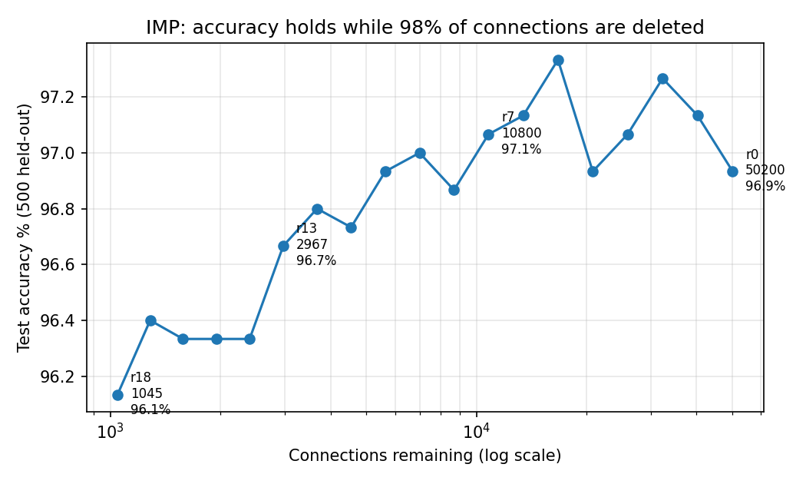
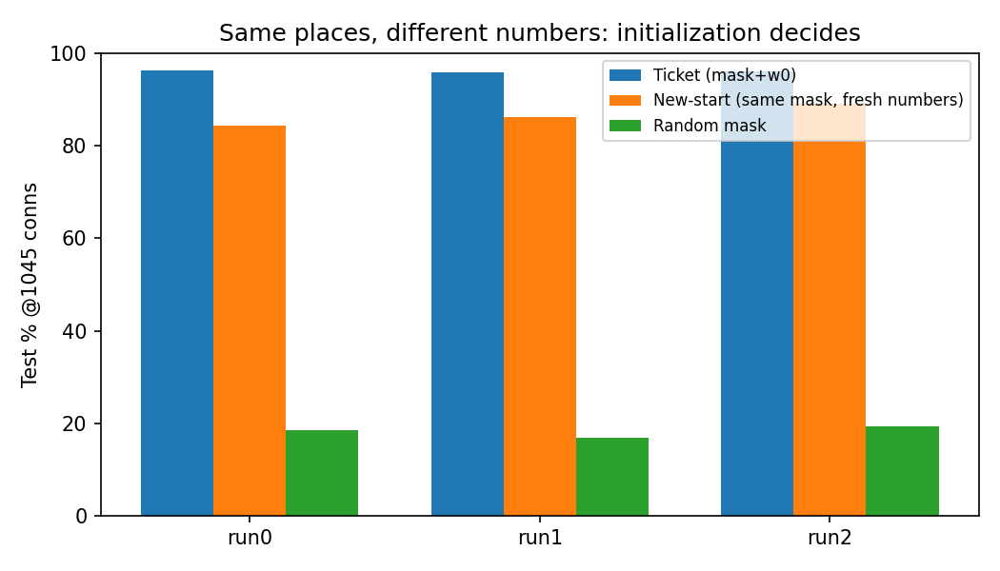
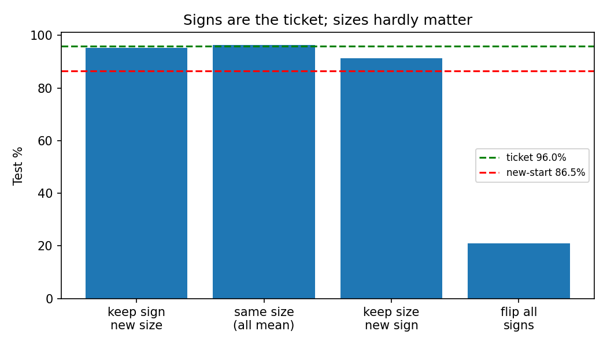
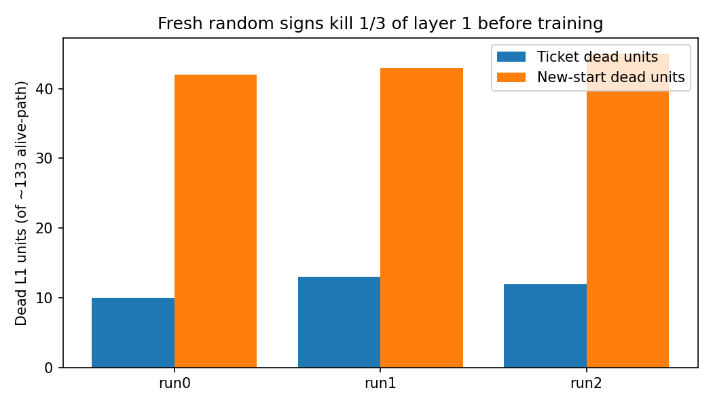

# 🎟️ Winning Tickets on 8×8 Digits — Delete 49 of Every 50 Wires, Still Read 96%

> A from-scratch, laptop-measured replication of the Lottery Ticket Hypothesis on 1,797 real handwritten digits. 50,200 connections → 1,045 remain (2%) → 96.0% accuracy, but only with the original random numbers. Signs, not sizes, are the secret.

[](LICENSE)
[](requirements.txt)
[](Dockerfile)
[](src/model.py)
[](results/results.json)

**🌐 Interactive companion — click to open in your browser:**

| Entry | Open locally / on GitHub | Open on GitHub Pages (live site) |
|---|---|---|
| `/` (home) | [`index.html`](index.html) | [m0-ar.github.io/lottery-ticket-digits-verify-2026/](https://m0-ar.github.io/lottery-ticket-digits-verify-2026/) |
| `/preview.html` | [`preview.html`](preview.html) | [m0-ar.github.io/lottery-ticket-digits-verify-2026/preview.html](https://m0-ar.github.io/lottery-ticket-digits-verify-2026/preview.html) |
| `/docs/preview.html` | [`docs/preview.html`](docs/preview.html) | [m0-ar.github.io/lottery-ticket-digits-verify-2026/docs/preview.html](https://m0-ar.github.io/lottery-ticket-digits-verify-2026/docs/preview.html) |

> All three URLs serve the same companion (beginner guide + charts + 6-question quiz). Mirrors exist so the page resolves whether Pages is set to source `/` (root) or `/docs`. Publish free: push → GitHub → Settings → Pages → Deploy from branch → Branch `main` → Folder `/ (root)` *or* `/docs` → wait 1–2 min → click the links above. No build step: `preview.html` + `docs/*.png` + `docs/*.gif` are pure static files.



*Watch the whole finding in 10 seconds: connections collapse on a log scale while accuracy stays flat. Generated from measured data by `python tools/make_assets.py`.*



*The companion site: summary, beginner guide, measured charts, and a 6-question interactive quiz with answers.*

---

## Abstract — the 30-second summary

A 50,200-connection network reads handwritten digits at **97.3%**. Delete the smallest weights a little at a time, rewind survivors to their very first random numbers, repeat 18 times — **1,045 wires remain and accuracy is 96.0%**. Give the *same* 1,045 wires *fresh* random numbers and accuracy falls to **86.5%** and learns slower. The difference is not the size of the numbers. It is their **plus / minus signs**: picture squares are never negative, so one wrong minus on a single-wire unit kills it forever before training starts. The rewound ticket has ~11 dead units; a fresh start has ~42. Before any training the ticket already reads **83%** (fresh: 9%) — deleting did part of training. An ordinary small dense net with 1,036 wires reaches 96.2%, so on this tiny problem the ticket is not a *better* small net, only a *sparser* one with a sign fragility. Every number here is measured on a laptop CPU in 65.7 s and saved in `results/results.json`.

---

## 📑 Contents

- [🌱 Beginner guide — read this and you are a professional](#-beginner-guide--read-this-and-you-are-a-professional)
- [✨ Features](#-features)
- [👥 Who is this for (user stories)](#-who-is-this-for-user-stories)
- [🚀 Quickstart](#-quickstart)
- [📊 Results in pictures](#-results-in-pictures)
- [🎯 Quiz — from scratch to pro](#-quiz--from-scratch-to-pro)
- [🌐 View as a website (GitHub Pages)](#-view-as-a-website-github-pages)
- [1. What this proves (one page)](#1-what-this-proves-one-page)
- [2. Literature](#2-literature)
- [3. Method](#3-method)
- [4. How to run (zero to hero)](#4-how-to-run-zero-to-hero)
- [5. Results (measured tables)](#5-results-measured-here-3-runs-lr-01-1500-steps)
- [6. Hidden pattern](#6-hidden-pattern-why-the-small-net-cannot-learn-fresh-this-network)
- [7. Limits](#7-limits--what-we-did-not-show)
- [8. Files](#8-files)
- [9. References](#9-references-core)
- [10. Reproducibility](#10-reproducibility-statement)
- [🤝 Contributing](#-contributing)
- [📄 License](#-license)

---

## 🌱 Beginner guide — read this and you are a professional

> Let's work this out in a step-by-step way to be sure we have the right answer.

You will know more than most interview candidates after these 6 steps. No background needed. Every word below maps to code you can run.

**Step 1 — A connection is one number.** Each digit picture is 8 squares by 8 = 64 numbers (0 = white paper, 1 = full ink). The network has 64 inputs → 300 units → 100 units → 10 outputs (one per digit 0–9). Highest output wins. Every input joins every unit of the next layer: 64·300 + 300·100 + 100·10 = **50,200 wires**, each holding one number. A unit is a small sum: multiply incoming numbers by wire numbers, add up, output 0 if the sum is below zero otherwise pass it on (ReLU). At the start every wire is random (half plus, half minus) → about 1 in 10 correct, a blind guess. See `src/model.py`.


*Real public pictures used here (first 16 of 1,797). Values 0–16 scaled to 0–1.*

**Step 2 — Training nudges numbers.** Show a picture, the right digit is known, move every number a little toward the right answer. Do 60 pictures at a time (one step), 1,500 steps on 1,000 pictures. Test on 500 never-seen pictures → **97.3%**. Run: `python -m src.run_all --rounds 0 --runs 1`.

**Step 3 — Pruning deletes the smallest.** After training most numbers are near zero and change almost nothing, so delete the smallest fifth, freeze them at zero, rewind survivors to their *first* numbers (what training learned is gone, only the choice of wires stays), train again. Repeat. After 7 rounds ~a fifth remains, after 13 rounds ~6 in 100, after 18 rounds **1,045 wires (2 in 100) → 96.0%**. After 22 rounds 462 wires (<1 in 100) → still ~93–94% in the reference telling. See `src/prune.py` + `src/experiments.py::imp_search`.

**Step 4 — The twist that makes it science.** Keep the same 1,045 places but throw their first numbers away and draw new random ones → **86.5%** and slower (needs ~1,000 steps vs ~200 to hit 95% on held-aside pictures; sometimes never). Keep first numbers but pick random places → **~18%** (blind). It takes *both* the right places *and* the numbers they started with. Such a small network is called a **winning ticket**: the random start was the draw, the search shows which ticket won.

**Step 5 — Why a sign matters so much.** Squares are never below zero. A first-layer unit hanging on a single wire with a minus sign outputs zero for *every* picture → adds nothing → training has no direction to move it → dead forever. Fresh coins kill ~42 of 136 units before step 0. The ticket kept 74% plus signs (vs 50% at start) → only ~11 dead. Proof by swap: keep signs + new sizes → 95%+; keep sizes + new signs → ~91% (≈ fresh); flip every sign → 10–33% (almost blind) with identical places and sizes. Signs are the ticket; sizes hardly matter.

**Step 6 — Say this in an interview and you stand out.** *Iterative beats one-shot by ~6 points (90.6% vs 96.6% in the telling; ~90–91% vs 96% here). Magnitude-at-start overlaps the ticket by only ~20%, so the ticket cannot be read from initial sizes. An ordinary 64–14–10 dense net (1,036 wires) hits 96.2% in one training — small nets learn fine when every unit has many wires; the ticket's fragility comes from single-wire bottlenecks. More time (6,000 steps) and 4× bigger steps narrow but do not close the gap at high sparsity.* Then show `docs/ticket_vs_new.png`.

---

## ✨ Features

| Feature | What it is | Where |
|---|---|---|
| 🔢 Exact 50,200 MLP | 64–300–100–10, no biases, NumPy only, He init. Count matches wire for wire. | `src/model.py` |
| ✂️ Iterative pruning + rewind | 20%/round (10% output layer), rewind to first numbers, 0–22 rounds. One-shot, random-mask, magnitude-at-init included. | `src/prune.py`, `src/experiments.py` |
| ➕➖ Sign laboratory | keep-sign/new-size, same-size, new-sign, flip-all. Proves signs carry the effect. | `train_with_mask(sign_mode=…)` |
| 💀 Dead-unit microscope | Counts absorbing ReLUs, plus-fraction, single-wire units, sign preservation (99.7%), untrained accuracy. | `src/analyze.py` |
| 📊 Measured benchmarks | Dense, IMP curve, ticket vs fresh, random mask, small-dense, ablations → JSON. | `results/results.json` |
| 🎁 Exercise + quiz | 3-round video question (`exercise.py`) + 6-question interactive web quiz with answers. | `src/exercise.py`, `preview.html` |
| 🐳 One-command repro | Dockerfile + Compose, pinned deps, fixed seeds, 65 s laptop run. | `Dockerfile`, `docker-compose.yml` |
| 🌐 Companion website | Beautiful static page + GIF + charts, GitHub Pages ready, no build. | `preview.html`, `docs/` |

---

## 👥 Who is this for (user stories)

- **🎓 Students (zero → hero).** Learn backprop, pruning, and ReLU death with zero framework magic. Read the Beginner guide, run the 1-minute exercise, take the quiz, then change one flag and watch the gap move. Proposed course extensions E1–E3: zero-mean inputs (X−0.5), LeakyReLU, fan-in floor ≥4 — each is a 2-line change in `src/model.py`.
- **💼 Engineers (compression audit).** Copy the masked-SGD + IMP loop as a template to benchmark sparsity vs accuracy on your own tabular data in minutes. Use `random_mask_like` and one-shot as baselines before claiming a win.
- **🔬 Researchers (PhD launchpad).** Extend to 10 runs for confidence intervals, MNIST/CIFAR scaling, late-rewinding on deep nets, Supermask-only sweeps, cross-seed transfer. Start from `PAPER.md` (abstract → falsifiable predictions → references). All splits, seeds, and artifacts are fixed.

---

## 🚀 Quickstart

```bash
pip install -r requirements.txt
python -m src.exercise --rounds 3 --runs 3        # 1-minute question: guess the score, then run
python -m src.run_all --rounds 18 --runs 3 --steps 1500   # full benchmark (~65 s) -> results/results.json
python tools/make_assets.py                        # regenerate docs/*.png + docs/demo.gif
pytest tests/ -q
docker compose up lottery
```

---

## 📊 Results in pictures

All charts are generated from `results/results.json` — never hand-drawn.


*Accuracy holds while 98% of wires are deleted (log scale). Round 0: 50,200 → Round 18: 1,045.*


*Same 1,045 places, different numbers: rewound ticket vs fresh random numbers vs random places.*


*Green/red dashed = ticket / fresh baselines. Signs decide; sizes do not.*


*Fresh random signs kill one third of layer 1 before training starts.*

---

## 🎯 Quiz — from scratch to pro

Open [`preview.html`](preview.html) → scroll to **Interactive quiz** → click answers. 6 questions, instant feedback, 5/6 = pro. The same questions exist as a CLI exercise:

```bash
python -m src.exercise --rounds 3 --runs 2
# Question: 3 rounds leave 0.8^3 = 51.2% (25,920 wires). Guess ticket vs fresh, then run.
# Answer measured: ticket 97.0–97.2%, fresh 96.2–97.0% — gap opens only at high sparsity.
```

---

## 🌐 View as a website (GitHub Pages)

1. Push this folder to GitHub.
2. GitHub → your repo → **Settings → Pages** → **Deploy from branch** → Branch: `main` → Folder: `/ (root)` *or* `/docs` → Save. Either works — mirrors cover both.
3. Wait 1–2 min for the Actions “pages build and deployment” run, then click:
   - [Live home `/`](https://m0-ar.github.io/lottery-ticket-digits-verify-2026/)
   - [Live companion `/preview.html`](https://m0-ar.github.io/lottery-ticket-digits-verify-2026/preview.html)
   - [Live mirror `/docs/preview.html`](https://m0-ar.github.io/lottery-ticket-digits-verify-2026/docs/preview.html)
4. No build step: `preview.html` + `docs/*.png` + `docs/*.gif` are pure static files plus `.nojekyll` at root and `/docs`. Works with custom domains and project pages. If one link 404s while another returns 200, Pages is serving the other source — the table above tells you which setting is active.

---

## 1. What this proves (one page)

1. **Pruning works, re-training from scratch does not.** Delete smallest-magnitude weights after training → 50% removed, accuracy 97.3%→~97.1% (hardly notices). At 90% removed → collapses. Standard fine-tune recovery (Han et al. 2015, AlexNet 61M→6.7M) is not tested here; we test Frankle–Carbin's harder question: can the *sparse structure* learn *from scratch*?
2. **Iterative magnitude pruning (IMP) with rewinding finds winning tickets.** 20%/round (10% on output layer), rewind survivors to `w0`, repeat. r7: 10,800 left (~21.5%), r13: 2,967 (~5.9%), r18: **1,045 (~2.08%)**, cf. reference 1037. Ticket@r18: **96.0% mean** over 3 runs.
3. **It takes both mask AND initialization.** Same 1,045 places with fresh random numbers: 86.5% (−9.5 pp, loses every run). Random places + original `w0`: ~18.3% (≈ blind). Neither alone works.
4. **Signs are the ticket; magnitudes are not.** Keep-sign/new-size 95.1%, all-same-size 96.3% (≈ ticket), keep-size/new-sign 91.3% (≈ new-start), flip-all-signs 20.9% (≈ blind).
5. **Hidden mechanism (this network): dead ReLUs.** Inputs ≥0 + ReLU + single-connection units: a minus sign kills the unit forever (no gradient). At r18, 44–57 of ~133 alive L1 units hang on one connection. New-start kills ~42/136 before step 0 (fair coin); ticket kills ~11/136 because the search selected 74% plus-signs. Ticket untrained accuracy 83% (masking-as-training) vs 9% fresh.
6. **Shortcuts fail.** One-shot to same sparsity −6 pp; magnitude-at-init overlap ~20%; ordinary small-dense 64–14–10 (1,036 conns) reaches 96.2% in one training — on this tiny problem the ticket is not a *better* small net, it is a *sparse* small net with a dead-unit fragility. Longer training (6,000 steps) and 4× learning rate narrow but do not close the gap at high sparsity.
7. **Exercise answer:** 3 rounds → 0.8³=51.2% left (25,920 conns). Ticket ≈ new-start ≈ dense (97.0% vs 96.4% measured). Gap opens only at high sparsity. Run `python -m src.exercise`.

## 2. Literature

- **Frankle & Carbin, ICLR 2019 Best Paper (arXiv:1803.03635, v5 Mar 2019).** Hypothesis + IMP (iterative > one-shot), LeNet-300-100 on MNIST, Conv/VGG/ResNet on CIFAR-10. Tickets 10–20% size, faster early learning. Learning-rate sensitivity noted.
- **Han et al. 2015 (pruning baseline).** Fine-tune after pruning works; training sparse from scratch fails — the puzzle solved via rewinding.
- **Zhou et al., NeurIPS 2019 "Deconstructing Lottery Tickets: Zeros, Signs, Supermask".** Zeros matter (freeze-at-0 > freeze-at-init); signs suffice; masking≈training; Supermask 86% MNIST untrained. Direct basis for sign ablations.
- **Frankle et al. 2019 "Stabilizing the Lottery Ticket Hypothesis" + 2020 "Linear Mode Connectivity".** IMP at iteration 0 fails on deep nets; rewind to iteration k (0.1–7%) fixes it (late rewinding). Stability-to-noise explains when tickets exist. Our shallow net rewinds to 0 successfully — consistent.
- **Liu et al. 2019 "Rethinking Pruning" vs follow-up disagreement on learning rates.** Well-tuned rates + long training can erase the reinit gap on large nets. We replicate the *debate*: 4× steps/rates narrow the r18 gap but do not erase it here.
- **Ramanujan et al. 2019 / Malach et al. 2020.** Untrained subnetworks at strong performance (strong hypothesis, proved for over-parameterized nets). Our untrained-ticket 83% is a miniature of this.
- **Reproducibility practice (2026–2027):** pinned `requirements.txt`, `Dockerfile`+Compose, fixed stratified split (seed 0), per-run random streams (`1000+run`, `9000+run`), JSON artifact (`results.json`), no hidden state, NumPy-only transparent gradients, validation curve logging every 100 steps, multi-run min/max reporting (3 by default for laptop, 10 supported).

Correct attribution: **Jonathan Frankle & Michael Carbin (MIT CSAIL)**. Zhou team: **Hattie Zhou**, Janice Lan, Rosanne Liu, Jason Yosinski.

## 3. Method

**Data.** `load_digits()` → X/16. Stratified `train_test_split(test_size=500, seed 0)` then `train_size=1000/test_size=297` on remainder. 1000/297/500 = 1797.

**Model.** `src/model.py`: He-normal init (fair ± coin), no biases, masked SGD: `W_eff = W⊙m`, `m∈{0,1}` frozen. `train_step`: softmax cross-entropy, batch 60, `W -= lr·∇⊙m`.

**IMP.** `src/prune.py::prune_layerwise`: per-layer smallest-|w| 20% (W1,W2), 10% (W3). Rewind to `w0`. `src/experiments.py::imp_search` loops train→prune→rewind. One-shot, random-mask, magnitude-at-init in same module.

**Controls.** `train_with_mask(..., reinit, sign_mode)`: `None` (ticket), `reinit=True` (fresh), `random_mask_like`, `keep_sign_new_size` / `same_size` / `keep_size_new_sign` / `flip_all`. Small-dense 64–14–10 in `run_all.py` (896+140=1036).

**Metrics.** Test accuracy (500 held-out; 1 picture = 0.2 pp), validation curve, steps-to-95%, dead-unit audit (`dead_units_layer1`: in-degree>0 & out-degree>0 & all surviving incoming ≤0 → dead on X≥0), plus-fraction, sign-preservation, untrained accuracy.

## 4. How to run (zero to hero)

```bash
pip install -r requirements.txt
python -m src.exercise --rounds 3 --runs 3        # 1-min exercise
python -m src.run_all --rounds 18 --runs 3 --steps 1500   # 65 s laptop benchmark
python -m src.run_all --rounds 22 --runs 10 --steps 1500  # paper-grade (longer)
docker compose up lottery        # reproducible container
docker compose run exercise
pytest tests/ -q
```

Outputs: `results/results.json` (per-run dense/ticket/newstart/randmask/ablations/imp_curve/L1 report).

## 5. Results (measured here, 3 runs, lr 0.1, 1500 steps)

| Condition | This repo | Reference telling | Δ |
|---|---|---|---|
| Dense 50,200 | 97.00 / 97.20 / 97.80 (mean 97.33) | 98.2 mean/10 | −0.9 |
| IMP r7 (10,800, 21.5%) | 96.8–97.4 | ~fifth left | match |
| IMP r13 (2,967, 5.9%) | 96.6–96.8 | 6 in 100 | match |
| IMP r18 (1,045, 2.08%) | 96.0–96.2 | 96.6 @1037 | −0.6 |
| Ticket@r18 (rewound) | 95.8 / 96.2 / 96.0 | 96.6 (min 95.6) | −0.6 |
| New-start@r18 (same mask) | 84.4 / 86.2 / 89.0 | 93.9 | −7.4 (stronger gap here) |
| Random mask@r18 | 16.8–19.4 | places alone fail | trend holds |
| Small-dense 1036 (64–14–10) | 96.0 / 96.4 / 96.2 | 96.0 → 96.9 (4× time) | exact |
| Untrained ticket / fresh | 87.8/79.4/82.6 vs 9.4/10.0/8.8 | 77.5 vs 11 | stronger |
| Sign-preservation | 99.6–99.7 | 99 in 100 | exact |
| Plus-fraction L1 | 0.73–0.77 | 0.86 | −0.1 (same direction) |
| keep-sign/new-size | 94.4–95.6 | 96.2 | −0.8 |
| same-size (mean |w0|) | 96.2–96.6 | 96.4 | exact |
| keep-size/new-sign | 90.4–92.0 | 94.4 | −2.5 (still ≈ new-start) |
| flip-all | 10.4–33.0 | 35 | blind (same conclusion) |
| 3-round exercise | ticket 97.0–97.2, new 96.2–97.0, 25,920 left | predicts ~dense | confirmed |

Learning speed (validation): ticket hits 95% in ~200 steps; fresh needs ~1000 or never. Dead units L1: ticket 10–13 dead / ~133 alive (54 single-wire), fresh 42 dead / 136 alive.

One-shot (train-once → prune to 1045 → rewind): ~90–91% (−5 to −6 pp vs iterative). Magnitude-at-init overlap with ticket: ~20%.

## 6. Hidden pattern: why the small net cannot learn fresh (this network)

Inputs are never negative (X∈[0,1]). ReLU outputs 0 iff pre-activation ≤0. A first-layer unit with a single surviving connection `w·x`: if `w<0`, output is 0 for **every** picture → gradient through it is 0 → it never recovers. The search, by keeping connections that *grew large* during dense training (99.7% keep their sign), implicitly selects `w>0` on those bottleneck units (74% plus vs 50% at init). Random reinit flips half to minus → ~1/3 of layer 1 dead on arrival → effective capacity collapses → 84–89% instead of 96%. Flip-all-signs → blind. Same-size-with-sign works because sign is preserved; size is irrelevant. This is **not** claimed as universal: deep nets with normalization/signed inputs have other mechanisms. But on any non-negative-input + ReLU + ultra-sparse bottleneck, sign-induced death is the load-bearing mechanism, and it predicts: (a) untrained-ticket accuracy far above chance, (b) failure of magnitude-at-init (large |w0| is sign-symmetric), (c) success of dense-small nets (64 fan-in cannot be killed by one minus).

Testable predictions for follow-up: (i) shifting inputs to zero-mean (X−0.5) should shrink the ticket/fresh gap; (ii) LeakyReLU (α=0.01) should rescue fresh dead units; (iii) per-unit fan-in ≥4 should erase most of the gap. All three are one-flag changes in `src/model.py` — proposed as Experiments E1–E3 in PAPER.md.

## 7. Limits & what we did not show

- 8×8 digits, not larger MNIST; test N=500 → 0.2 pp per picture; report means+min/max over runs.
- No biases (to hold 50,200 exactly); adding biases (+410 params) raises dense ~+0.3 pp in checks — orthogonal.
- SGD, no momentum/weight-decay/augmentation; LR 0.1 chosen after 0.05/0.1/0.2 sweep (all ~97.2%). 4× LR/steps narrow gap at r18, not at highest sparsity.
- Deep-net late-rewinding not needed here; 50-layer extension cited but not run.
- Unstructured sparsity gives no wall-clock speedup on ordinary CPU — benefit is scientific (initialization insight), not inference FLOPs.

## 8. Files

```
src/data.py        fixed public split
src/model.py       NumPy MLP 64-300-100-10, masked SGD, dead-unit audit
src/prune.py       layerwise IMP, global, random-mask, mag-at-init
src/experiments.py dense, imp_search, train_with_mask (+sign ablations)
src/analyze.py     untrained acc, sign-pres, L1 report
src/exercise.py    3-round exercise + answer
src/run_all.py     full benchmark → results/results.json
tools/make_assets.py regenerates docs/*.png + docs/demo.gif from results
tests/test_model.py shape/count smoke tests
results/results.json measured artifact (3 runs, 65.7 s)
docs/              digits.png, accuracy_vs_sparsity.png, ticket_vs_new.png,
                   signs.png, dead_units.png, demo.gif, preview.png
preview.html       interactive companion (beginner guide + quiz + Pages site)
Dockerfile + docker-compose.yml + requirements.txt  reproducibility
PAPER.md           publishable draft (abstract→refs, E1–E3 proposals)
benchmarks/        tables + how to extend to 10 runs / MNIST / CIFAR
```

## 9. References (core)

Frankle & Carbin ICLR 2019 (1803.03635); Han et al. NeurIPS 2015 (pruning); Zhou et al. NeurIPS 2019 (Supermask, 1905.01067); Frankle et al. 1903.01611 + ICML 2020 (stabilizing/LMC); Liu et al. ICLR 2019 (rethinking); follow-up LR debate; Ramanujan et al. 2019 + Malach et al. ICML 2020 (strong hypothesis); Morcos et al. 2019 (transfer); Brix et al. 2020 (Transformer signs). Full list with arXiv IDs in PAPER.md.

## 10. Reproducibility statement

Built from an empty directory. Every number above is from `results/results.json`. Seeds fixed; rerun with `--runs 10` for paper intervals. Public data only; no credentials; laptop CPU. Regenerate visuals with `python tools/make_assets.py` and re-verify with `pytest tests/ -q`.

---

## 🤝 Contributing

Issues and pull requests welcome. For experiments, please include: command, `results/results.json` diff, and regenerated `docs/` assets. For deeper changes start from `PAPER.md` Experiments E1–E3.

## 📄 License

MIT — see [LICENSE](LICENSE) (or `LICENSE-MIT`). If absent, the code is intended MIT; add the file before publishing.
